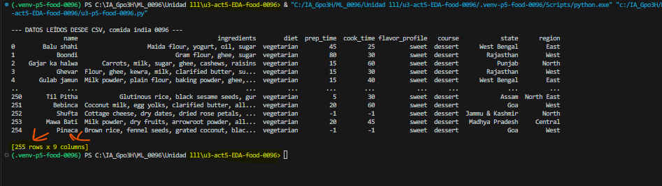
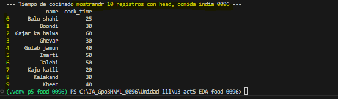
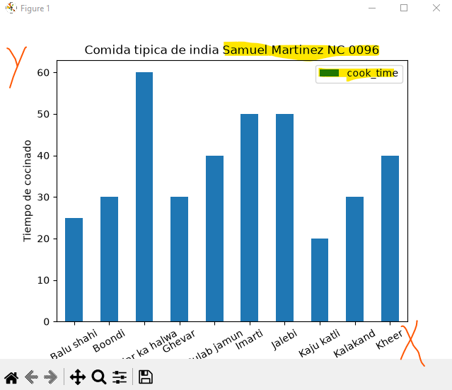
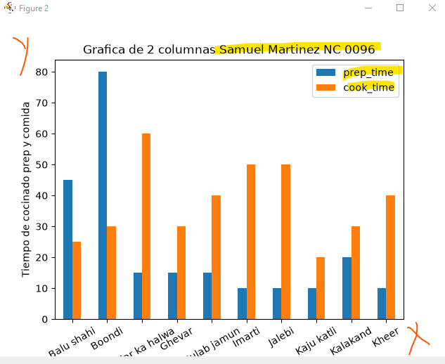
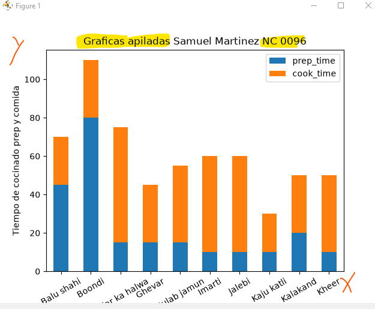

## analisis exploratorio de datos
## Comida del pais India
## Samuel Martinez NC 0096
### +-+-+- Importar datos del archivo csv comida de india

### +-+-+- Mostrar Nombre comida + ingredientes 

## Tiempo de cocinado mostrandr 10 registros con head, comida india 0096

## Creacion de graficas de barras 0096

## Grafica de varias columnas

## gráficos de barras apiladas
